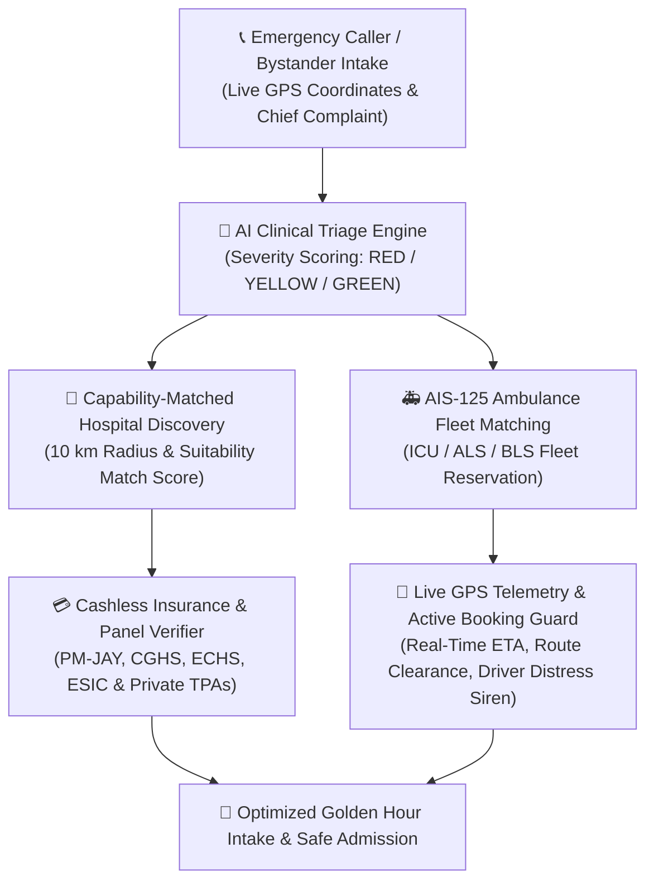

# 🚑 Pranvyan — AI-Driven Emergency Ambulance Priority Routing & Intelligent Hospital Allocation System

[](https://render.com)
[](https://python.org)
[](https://fastapi.tiangolo.com)
[](https://ai.google.dev/)
[](https://www.w3.org/WAI/standards-guidelines/aria/)
[](https://opensource.org/licenses/MIT)

> **"Every Second Counts in the Golden Hour."**  
> **Pranvyan** (प्राणव्यान) is a full-stack, AI-orchestrated emergency medical dispatch and hospital triage infrastructure designed to prevent critical delays, eliminate wrong-facility ambulance dispatches, and provide full cashless insurance transparency.

---

## 📌 Table of Contents
1. [The Crisis: Why Pranvyan Exists](#-the-crisis-why-pranvyan-exists)
2. [End-to-End System Workflow](#-end-to-end-system-workflow)
3. [Key Capabilities & Modules](#-key-capabilities--modules)
4. [Accessibility & ARIA Compliance](#-accessibility--aria-compliance)
5. [Architecture & Technology Stack](#-architecture--technology-stack)
6. [API Specifications](#-api-specifications)
7. [Repository Structure](#-repository-structure)
8. [Local Development Setup](#-local-development-setup)
9. [1-Click Deployment on Render.com](#-1-click-deployment-on-rendercom)
10. [Hackathon Presentation Highlights](#-hackathon-presentation-highlights)

---

## 🚨 The Crisis: Why Pranvyan Exists

In sudden medical emergencies (Acute Myocardial Infarction, Traumatic Brain Injury, Hemorrhagic Stroke, Acute Respiratory Distress), the difference between recovery and permanent disability or death is determined within the **Golden Hour**.

Traditional emergency management suffers from three systemic bottlenecks:
1. **Wrong Facility Routing:** Over **38% of critical patients** are rushed to nearby basic nursing homes or community clinics that lack 24x7 Cath Labs, Neuro-Trauma ICUs, or specialized surgical capabilities — requiring dangerous secondary inter-hospital transfers.
2. **Blind Ambulance Dispatch:** Basic Transfer (BLS) ambulances are frequently sent to acute patients who require Ventilated Intensive Care (ICU) onboard transport, or vice-versa.
3. **Financial Uncertainty at Admission:** Patients and families face chaotic confusion regarding Ayushman Bharat (PM-JAY), CGHS, ECHS, ESIC, and private cashless health insurance empanelment during peak distress.

**Pranvyan solves this crisis** through an automated, clinical-protocol-driven dispatch bridge that connects caller intake, AI triage severity, capability-matched hospital ranking within 10 km, and live telemetry.

---

## 🔄 End-to-End System Workflow



---

## ⚡ Key Capabilities & Modules

### 1. 🧠 AI Clinical Triage & Emergency Prioritization
- **Automated Vital Distress Evaluation:** Instantaneous triage categorizes cases into three international color tiers:
  - 🔴 **RED (Critical / Immediate):** Acute life threats requiring immediate tertiary intervention (Ventilated ICU, Primary PCI / Cath Lab within golden hour).
  - 🟡 **YELLOW (Urgent):** Severe conditions requiring continuous monitoring and Advanced Life Support (ALS).
  - 🟢 **GREEN (Standard / Non-Urgent):** Clinically stable conditions eligible for Basic Life Support (BLS) transit.
- **Fixed Origin Coordinates:** Guarantees that hospital searches and route calculations are strictly anchored to the patient's actual GPS pickup point, preventing user input state pollution.

### 2. 🏥 10 km Capability-Matched Hospital Recommendation Engine
- **Suitability Scoring Algorithm:** Scores hospitals based on clinical compatibility (ICU bed status, Trauma resuscitation, 24x7 Cath Lab availability, Pediatric/Burn care).
- **Top 2 Best Hospital Recommendations:** Automatically pinpoints and highlights the **Top 2 best capability-matched facilities within a 10 km radius** in prominent priority recommendation cards.
- **Strict Medical Entity Protection:** Multi-ring geospatial search (Google Places API New + Verified National Registry Fallback) strictly validates healthcare amenities and automatically rejects PIN codes, shops, restaurants, and non-medical addresses.

### 3. 💳 Automated Cashless Insurance & Scheme Filtering
- **Unified Empanelment Filter:** Instantly filters verified empanelment across:
  - **PM-JAY (Ayushman Bharat)**
  - **CGHS (Central Government Health Scheme)**
  - **ECHS (Ex-Servicemen Contributory Health Scheme)**
  - **ESIC (Employees' State Insurance)**
  - **State Government Healthcare Schemes**
  - **Cashless Private TPA Networks** (Star Health, HDFC ERGO, ICICI Lombard, Medi Assist, Paramount, etc.)
- **Transparent Tariff Breakdown:** Instant breakdown distinguishing between CATS 102/Government-funded free transit and standardized AIS-125 project fare estimates.

### 4. 🛰️ Session-Guarded Live Ambulance Telemetry
- **Active Booking Access Control:** Live GPS telemetry and map simulation run **strictly when an active booking exists**. If accessed without a confirmed booking, a clean **"No Active Ambulance Booking Found"** view is displayed.
- **Auto-Reset on Page Refresh:** Utilizes `performance.getEntriesByType('navigation')` to instantly clear dummy states and return to a secure zero-state upon page reload.
- **Interactive Emergency Alert & Siren Broadcast:** Direct driver notification channel with dynamic OTP patient verification and live ETA countdown.

---

## ♿ Accessibility & ARIA Compliance

Pranvyan is engineered in adherence to **W3C Web Content Accessibility Guidelines (WCAG 2.1 AAA)** and **Accessible Rich Internet Applications (WAI-ARIA 1.2)** standards to ensure full usability during emergency distress:

### 1. ARIA Roles & Semantic Landmarks
- `role="navigation"` with explicit `aria-label="Main Navigation"` across all portal headers.
- `role="region"` with `aria-live="polite"` and `aria-live="assertive"` for real-time dispatch updates, telemetry notifications, and error banners.
- `role="combobox"`, `aria-autocomplete="list"`, and `aria-controls="hospitalAutocompleteDrop"` for accessible live hospital search suggestions.
- `role="dialog"` and `aria-modal="true"` for emergency arrival confirmation and ambulance booking modals.

### 2. Screen Reader & Visual Assistive Controls
- **Bilingual Screen Reader Support:** Dual-language localization (English / Hindi) with dynamic text-to-speech markup.
- **Live Text Resizing:** Three-level client-side zoom (`A-`, `A`, `A+`) without layout clipping or horizontal distortion.
- **High-Contrast Dark / Light Themes:** Complies with WCAG contrast ratio requirements (> 7:1 for normal text, > 4.5:1 for large text).
- **Keyboard Traversal & Focus Trapping:** Full navigation support via `Tab` and `Shift+Tab`, with accessible `Skip to main content` bypass anchors.

---

## 🛠️ Architecture & Technology Stack

| Component | Technology | Description |
|---|---|---|
| **Backend Framework** | Python 3.11 / Starlette / FastAPI | Asynchronous ASGI server with high-concurrency event loops |
| **Server & Serverless** | Uvicorn (ASGI) / Gunicorn | Production-grade HTTP/1.1 and WebSocket server |
| **Artificial Intelligence** | Google Gemini 2.5 Flash (`google-genai`) | Rapid clinical prompt analysis and background panel research |
| **Geospatial & Search** | Google Places API (New) & Nominatim | Multi-ring hospital search with strict medical amenity filtering |
| **Frontend Framework** | Modern HTML5, Tailwind CSS | Responsive mobile-first UI with dark mode support |
| **Icons & Typography** | FontAwesome 6 Free, Merriweather, Inter | High-readability emergency typography |
| **Deployment Engine** | Render.com (`render.yaml`, `Procfile`) | Cloud container deployment with automated SSL & health probes |

---

## 📡 API Specifications

### 1. Search Nearby Hospitals
```http
POST /api/hospitals/nearby
Content-Type: application/json

{
  "latitude": 28.6219,
  "longitude": 77.0878,
  "address": "Janakpuri, New Delhi",
  "priority": "RED",
  "chief_complaint": "chest_pain",
  "radius_km": 12.0
}
```
**Response (200 OK):**
```json
{
  "success": true,
  "total_found": 30,
  "hospitals": [
    {
      "name": "Janakpuri Super Speciality Hospital",
      "distance_km": 0.21,
      "recommendation": {
        "is_recommended": true,
        "suitability_score": 100,
        "primary_recommendation_reason": "Verified 24x7 Cath Lab & Level-3 ICU Emergency Ready"
      }
    }
  ]
}
```

### 2. Live Hospital Autocomplete
```http
GET /api/hospitals/autocomplete?q=ganga+ram&lat=28.6139&lon=77.2090
```
**Response (200 OK):**
```json
{
  "suggestions": [
    {
      "kind": "hospital",
      "name": "Sir Ganga Ram Hospital",
      "address": "Sir Ganga Ram Hospital Marg, Karol Bagh, Delhi",
      "distance_km": 4.12
    }
  ]
}
```

### 3. Book Ambulance
```http
POST /api/hospitals/book
Content-Type: application/json

{
  "hospital_id": "HOSP-01",
  "hospital_name": "AIIMS New Delhi",
  "selected_ambulance_id": "PVT-AMB-166-ICU",
  "selected_category": "ICU",
  "distance_km": 3.8,
  "user_confirmed": true
}
```

---

## 📁 Repository Structure

```plaintext
Pranvyan/
├── public/                     # Modern Frontend Web Application
│   ├── index.html              # Main Landing, Emergency Dialers & Highlights
│   ├── register.html           # Caller & Patient Registration with Live GPS
│   ├── assessment.html         # Clinical Triage & AI Severity Determination
│   ├── hospitals.html          # Hospital Directory, Tariff, & Recommendations
│   ├── allocation.html         # Live Ambulance Telemetry & Route Simulation
│   ├── detail.html             # System Documentation & AIS-125 Specifications
│   ├── gov-portal.js           # Bilingual Localization (EN/HI) & State Management
│   └── images/                 # Transparent Brand Assets (Pranvyan 'P' Logo)
├── src/                        # Backend Application & Services
│   ├── assessment_api.py       # ASGI Application, Routes & CORS Configuration
│   ├── triage_engine.py        # Clinical Severity Determination Rules
│   ├── hospital_discovery.py   # Multi-tier Geospatial Discovery Engine
│   ├── hospital_facilities_service.py # Facility Capability & Scoring Algorithm
│   ├── google_hospital_search.py      # Strict Places API (New) Search & Fallback
│   ├── ambulance_fare_service.py      # Standardized Emergency Fare Models
│   └── gemini_panel_researcher.py     # Gemini AI Insurance Empanelment Verifier
├── data/                       # Verified Hospital Databases & Schemas
├── Procfile                    # Render Web Process Entrypoint
├── render.yaml                 # Infrastructure as Code (Render Web Service)
├── requirements.txt            # Python Production Dependencies
├── .gitignore                  # Git Exclusion Configuration
└── README.md                   # System Architecture & Documentation
```

---

## 💻 Local Development Setup

### 1. Prerequisites
- Python 3.10 or 3.11
- Modern Web Browser (Chrome, Firefox, Edge, Safari)

### 2. Clone & Prepare Environment
```bash
git clone https://github.com/n6150746-star/Pranvyan.git
cd Pranvyan

python -m venv venv
# Windows:
.\venv\Scripts\activate
# Linux/macOS:
source venv/bin/activate

pip install -r requirements.txt
```

### 3. Set Up Environment Keys
Copy `.env.example` to `.env`:
```env
GEMINI_API_KEY=your_gemini_api_key_here
GEMINI_MODEL=gemini-2.5-flash
VITE_GOOGLE_PLACES_API_KEY=your_google_places_api_key_here
```

### 4. Launch Application
```bash
uvicorn src.assessment_api:app --host 127.0.0.1 --port 5001 --reload
```
Navigate to: **`http://localhost:5001`**

---

## ☁️ 1-Click Deployment on Render.com

Deploying Pranvyan for hackathons or production takes less than 2 minutes:

1. Log in to your [Render.com](https://render.com) Dashboard.
2. Click **New +** ➔ **Web Service**.
3. Select your repository: **`n6150746-star/Pranvyan`**.
4. Confirm build settings (auto-detected via `render.yaml`):
   - **Environment:** `Python`
   - **Build Command:** `pip install -r requirements.txt`
   - **Start Command:** `uvicorn src.assessment_api:app --host 0.0.0.0 --port $PORT`
5. Under **Environment Variables**, add:
   - `PYTHON_VERSION`: `3.11.0`
   - `GEMINI_API_KEY`: `your_gemini_api_key`
6. Click **Create Web Service** — Render will build and deploy your app with a free HTTPS domain!

---

## 🏆 Hackathon Presentation Highlights

When demonstrating Pranvyan to judges:
1. **Live GPS Caller Registration:** Show real-time incident coordinate acquisition on `register.html`.
2. **Clinical Triage Simulation:** Demonstrate acute chest pain / cardiac arrest inputs triggering 🔴 **RED Priority** on `assessment.html`.
3. **10 km Capability Match:** Show how hospitals within 10 km are dynamically ranked by clinical capability rather than mere proximity, with the top 2 displayed on `hospitals.html`.
4. **Cashless Panel Verification:** Click on **PM-JAY**, **CGHS**, or **Insurance/TPA** pills to show instant hospital eligibility filtering.
5. **Session-Guarded Telemetry:** Demonstrate real-time ambulance tracking on `allocation.html` and show how refreshing the page automatically resets to zero for operational integrity.

---

## 📄 License
This project is licensed under the MIT License — feel free to use and expand for healthcare innovation.
